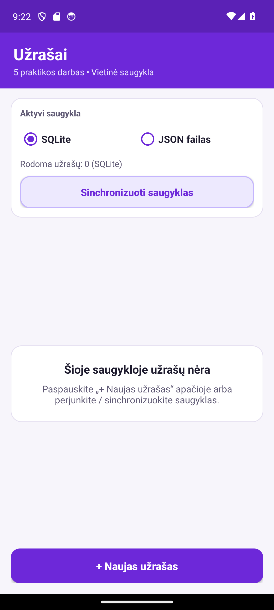
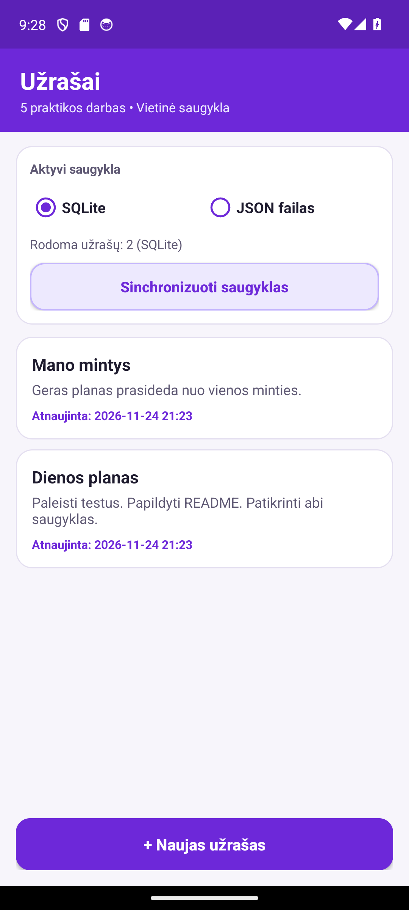
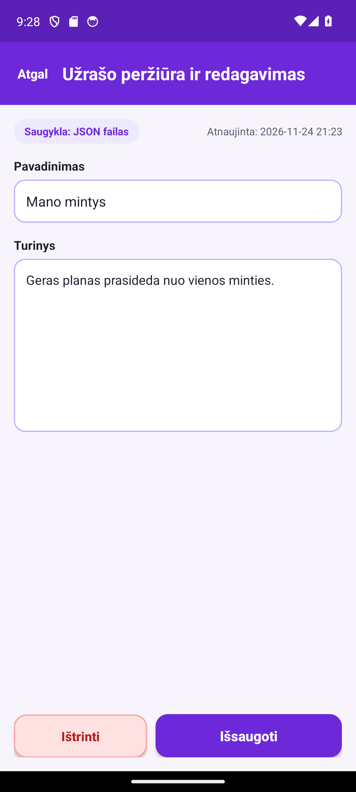

# Užrašai

„Užrašai“ yra mokomoji „Android“ užrašų programėlė (5 praktikos darbas), skirta patogiam asmeninių užrašų kūrimui, peržiūrai, redagavimui ir tvarkymui viename įrenginyje be interneto ryšio ar debesies paslaugų.

## Ekrano vaizdai

<p>
  
  
  
</p>

## Funkcijos ir naudojimas

Programėlę sudaro du pagrindiniai ekranai: **užrašų sąrašas** ir **užrašo peržiūra / redagavimas**.

### Užrašų kūrimas ir tvarkymas
- **Naujas užrašas**: sąrašo ekrane paspauskite mygtuką **+ Naujas užrašas**.
- **Peržiūra ir redagavimas**: paspaudus esamą užrašą sąraše, atidaromas redaktorius su laukais **Pavadinimas** ir **Turinys** bei veiksmais **Išsaugoti**, **Ištrinti** ir **Atgal**.
- **Privalomi laukai**: tiek **Pavadinimas**, tiek **Turinys** yra privalomi. Užrašai, kuriuose įvesti tik įprasti ar „Unicode“ tarpai, neleidžiami.
- **Apsauga nuo netyčinių veiksmų**:
  - Paspaudus **Ištrinti**, visada prašoma patvirtinimo.
  - Bandant išeiti iš redaktoriaus su neišsaugotais pakeitimais (pvz., paspaudus **Atgal**), parodomas perspėjimas.
- **Ekrano pasukimas**: pasukus įrenginį, redaguojamas juodraštis ir vykstančių operacijų būsena bei rezultatai išlieka neprarasti.

### Vietinės saugyklos („SQLite“ ir „JSON failas“)
Programėlėje naudojamos dvi vietinės saugyklos tame pačiame įrenginyje:
- **SQLite** – pirminė duomenų bazės saugykla.
- **JSON failas** – antrinė saugykla, laikoma privačiuose programėlės duomenyse UTF-8 koduote (šio failo nereikia ieškoti telefono failų tvarkyklėje).

Sąrašo ekrane esantis pasirinkimas **Aktyvi saugykla** leidžia perjungti tarp **SQLite** ir **JSON failas**:
- Iki sinchronizavimo abi saugyklos veikia visiškai nepriklausomai – sąraše matomi tik tuo metu aktyvios saugyklos užrašai.
- Pasirinkta aktyvi saugykla išsaugoma ir išlieka paleidus programėlę iš naujo.

### Saugyklų sinchronizavimas
Paspaudus **Sinchronizuoti saugyklas**, abiejų vietinių saugyklų turinys sujungiamas abiem kryptimis:
- Jei tas pats užrašas buvo keistas abiejose saugyklose, išlieka naujesnė jo versija.
- Užrašų ištrynimai taip pat perduodami kitai saugyklai, todėl ištrintas užrašas po sinchronizavimo nebeatsiranda iš naujo.

> **Svarbu:** saugyklų sinchronizavimas veikia tik tarp šių dviejų vietinių saugyklų įrenginyje. Tai **nėra** debesies sinchronizavimas ar atsarginė kopija – pašalinus programėlę arba išvalius jos duomenis sistemos nustatymuose, visi vietiniai užrašai bus negrįžtamai prarasti.

### Kalbos pasirinkimas
Programėlė palaiko **lietuvių** ir **anglų** kalbas:
- Pagal numatymą kalba parenkama atsižvelgiant į įrenginio sistemos kalbą (kitomis kalbomis naudojama anglų kalba).
- Įrenginiuose su **Android 13** arba naujesne versija programėlės kalbą galima atskirai pakeisti įrenginio sistemos programų nustatymuose.
- Visi naudotojui matomi tekstai aprašyti „Android“ ištekliuose (`strings.xml`), todėl esant poreikiui galima lengvai pridėti papildomą kalbą sukuriant `values-xx/strings.xml` failą.

---

## Aplinkos reikalavimai ir paleidimas

### Techniniai reikalavimai
- **Įrenginys / OS:** Android 8.0 (API lygis 26) arba naujesnis.
- **SDK:** `compileSdk 35`, `targetSdk 35`.
- **Įrankiai:** Android Gradle Plugin `8.9.2`, Gradle `8.11.1`, Java `17` šaltinio lygis (projekto patikroms naudojama Java `21`).
- **Android SDK konfigūracija:** kompiuteryje turi būti įdiegtas Android SDK; lokalų jo kelią nurodo failas `local.properties`, kuris nėra įtraukiamas į Git saugyklą.

### Paleidimas per „Android Studio“
1. Atidarykite šakninį projekto aplanką programoje **Android Studio**.
2. Palaukite arba paleiskite **Gradle Sync**, kad būtų paruoštos priklausomybės.
3. Pasirinkite prijungtą fizinį „Android“ įrenginį arba emuliatorių ir paspauskite **Run**.

### APK surinkimas iš komandinės eilutės
Derinimo (*debug*) versijos diegimo paketas (`app/build/outputs/apk/debug/app-debug.apk`) sukuriamas komandomis:

- **Windows:**
  ```powershell
  .\gradlew.bat assembleDebug
  ```
- **Linux / macOS:**
  ```bash
  ./gradlew assembleDebug
  ```

---

## Patikra ir dokumentacija

### Testai ir kodo analizė (*Lint*)
Vienetų testams ir statinei kodo analizei paleisti naudokite:

- **Windows:**
  ```powershell
  .\gradlew.bat testDebugUnitTest lintDebug
  ```
- **Linux / macOS:**
  ```bash
  ./gradlew testDebugUnitTest lintDebug
  ```

Instrumentiniams testams (būtinas prijungtas „Android“ įrenginys arba paleistas emuliatorius):

- **Windows:**
  ```powershell
  .\gradlew.bat connectedDebugAndroidTest
  ```
- **Linux / macOS:**
  ```bash
  ./gradlew connectedDebugAndroidTest
  ```

### Papildomi projekto dokumentai
- Kodo peržiūros pastabos ir du svarbiausi įgyvendinti pakeitimai aprašyti dokumente [`docs/CODE_REVIEW.md`](docs/CODE_REVIEW.md).
- Galutinės projekto patikros suvestinė bus išsaugota faile [`docs/verification/summary.json`](docs/verification/summary.json).

## Patikros rezultatai

Galutinė patikra atlikta **2026-11-24**:

- `assembleDebug`: surinkimas sėkmingas.
- `testDebugUnitTest`: **23** testai (0 nesėkmių, 0 klaidų, 0 praleistų).
- `connectedDebugAndroidTest` (`Pixel_6` / Android 14 emuliatoriuje): **3** testai (0 nesėkmių, 0 klaidų, 0 praleistų).
- `lintDebug`: **0** klaidų ir **20** įspėjimų.

Testai apima CRUD operacijas, pakartotinį JSON atnaujinimą, UTF-8 koduotę, sinchronizavimo konfliktus ir ištrynimus, nepavykusį rašymą bei ekrano pasukimą vykstant išsaugojimui, trynimui ar sinchronizavimui. Faktiniai JUnit XML ir `lint` ataskaitos failai saugomi `docs/verification/`, o galutinė suvestinė – faile [`docs/verification/summary.json`](docs/verification/summary.json).
